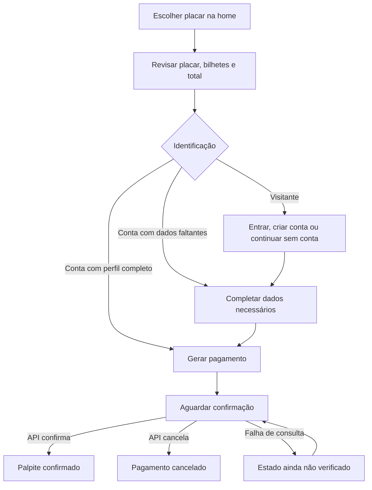

# Planejamento — tela principal do Bolão Celeste

Data: 09/10/2026. Status: implementado no ambiente local. Resultados de validação e limites do ambiente registrados na seção 12.

## 1. Objetivo e decisões

Criar uma tela principal simples, moderna e fácil de entender, na qual a pessoa identifica a partida, escolhe o placar, entende o valor e continua até a confirmação do pagamento.

Preferência confirmada: **tema escuro, com azul-marinho e menos efeitos**. O azul do Cruzeiro será o destaque principal. A identidade esportiva virá dos escudos, da partida e do placar, com tipografia sóbria e superfícies discretas.

Aplicar a skill `redesign-existing-projects`: analisar a interface existente, diagnosticar dificuldades e propor melhorias pontuais na stack atual. As técnicas decorativas da skill serão selecionadas conforme este objetivo; animações elaboradas e sobreposições não são necessárias para este fluxo. A Manrope existente pode ser mantida: a principal mudança tipográfica será de hierarquia e legibilidade.

**Ordem de importância:** escolher o placar → conhecer o valor → revisar e identificar-se → pagar → acompanhar → consultar a comunidade.

Escopo principal: `/`, cabeçalho e navegação compartilhados, seletor de placar, resumo do bolão e fluxo de palpite aberto pela home. Componentes compartilhados também exigem verificação em `/matches`, `/my-bets` e `/leaderboard`. O painel administrativo não faz parte do redesenho.

## 2. Diagnóstico do estado atual

Base: leitura de componentes e contratos da API, navegação local e capturas com dados fictícios em 390 × 900 e 1440 × 900. As observações abaixo não equivalem a um teste com usuários.

| Achado | Consequência | Decisão proposta |
|---|---|---|
| Banner e histórico aparecem antes da partida disponível | A ação principal exige rolagem | Colocar a partida e o seletor no primeiro bloco |
| Botão de palpite a aproximadamente 1.179 px do topo no celular e 976 px no desktop | A ação fica fora da primeira tela nas resoluções examinadas | Mostrar seletor, preço e botão juntos, acima das informações secundárias |
| Feed com 20 eventos; página com cerca de 4.370 px de altura no celular | Ranking e outros dados ficam distantes | Exibir quatro atividades inicialmente, com expansão explícita |
| Uso recorrente de caixa alta, itálico, brilho, gradientes, estrelas e amarelo decorativo | Muitos elementos disputam atenção | Azul-marinho uniforme, texto em frase normal e destaque azul concentrado na ação |
| Escudos, nomes abreviados e controles de gols ficam separados | Relação entre equipe e número depende de interpretação | Manter nome completo, escudo e controle no mesmo grupo |
| Seletor começa em 2 × 0; incremento da home não respeita o máximo 20 da API | Placar inicial favorece uma equipe e há validação inconsistente | Rascunho neutro em 0 × 0; mesmos limites em todas as etapas |
| Preço por bilhete aparece somente após abrir o modal | Compromisso financeiro é apresentado tarde | Mostrar preço antes do primeiro botão de continuidade |
| `/matches` reutiliza o mesmo seletor de uma única partida, mesmo com duas disponíveis na API | A segunda partida fica sem acesso pelo seletor atual | Incluir troca explícita de partida no componente compartilhado |
| Etapas indicadas apenas por números | Não fica claro o que falta | Usar os nomes “Palpite”, “Dados” e “Pagamento” |
| Usuário autenticado com perfil incompleto pula diretamente para o pedido | Erro de CPF/telefone/PIX aparece no final | Detectar campos faltantes antes de gerar o pagamento |
| Fechar o modal limpa linhas, pedido e status | É fácil perder o contexto ou criar outro pedido | Separar fechamento visual de descarte; preservar rascunho e pedido na sessão |
| Resumo pode exibir ícone verde com pagamento pendente | A pessoa pode entender que já está participando | Reservar aparência de confirmação ao status confirmado pela API |
| Textos fixos de “PIX manual” coexistem com integração automática | Instruções contraditórias | Exibir instrução conforme `payment.method` |
| “Palpite líder: 14%” sem explicação da base | Pode parecer probabilidade de vitória ou percentual de pessoas | Explicar que representa bilhetes confirmados, em informação secundária |
| “Acertos” no ranking representa uma média ponderada de resultados exatos e parciais | Rótulo não corresponde ao cálculo intuitivo | Exibir pontos e número de placares exatos na home |
| Há 11 participantes da partida e 13 cadastrados ativos, em blocos próximos | Números parecem discordar | Usar na home a contagem de participantes da partida, com rótulo explícito |
| Grêmio aparece com escudo do Arsenal na captura atual | Prejudica identificação e confiança | Revisar associação entre equipe e imagem; usar fallback neutro até ter ativo correto |
| Botão de notificação sem ação e indicador vermelho fixo no cabeçalho autenticado | Sugere uma função e uma notificação inexistentes | Retirar da composição enquanto não houver dados e interação |

Capturas locais de referência: `/tmp/celeste-redesign-before-390.png`, `/tmp/celeste-redesign-before-1440.png` e `/tmp/celeste-redesign-checkout-before.png`. Esses arquivos temporários não são necessários para implementar o plano.

## 3. Estrutura da nova home

### 3.1 Cabeçalho

- Marca “Bolão Celeste”, com altura aproximada de 64 px no desktop e 56 px no celular.
- Navegação desktop: Início, Jogos, Ranking e Meus palpites. Mesma ordem e terminologia no mobile.
- Visitante: “Entrar” como ação discreta e “Criar conta” como link secundário. O destaque preenchido da tela pertence ao palpite.
- Autenticado: avatar/iniciais e menu de conta com nome acessível, teclado, fechamento por Escape e estado expandido anunciado.
- Navegação mobile com quatro destinos e o botão “+” central. O botão abre a mesma revisão de palpite da ação principal, usando a partida e o placar selecionados.

### 3.2 Primeiro bloco: faça seu palpite

Título curto: **“Qual vai ser o placar?”**. Texto de apoio: “Escolha o resultado da próxima partida do Cruzeiro.”

O painel contém, nesta ordem:

1. Campeonato, data e horário do jogo.
2. Nome e escudo de cada equipe, junto dos respectivos controles de gols.
3. Instrução curta: “Ajuste os gols de cada time.”
4. Resumo legível do rascunho: “Seu palpite: Cruzeiro 2 × 1 Grêmio”.
5. Preço: “1 bilhete · R$ 20,00”, com valor vindo da partida.
6. Botão principal: **“Revisar palpite”**.
7. Prazo e condição: “Palpites até 11 out., às 16h” e “Válido após a confirmação do pagamento”.

As datas e os valores acima são exemplos do banco de demonstração, não informações fixas. Exibir horários no fuso definido pelo produto, com indicação “horário de Brasília” nos detalhes.

Se houver mais de uma partida disponível, oferecer “Trocar partida” próximo à identificação do confronto. Abrir uma lista compacta com equipes, datas e disponibilidade, usando `/matches/active`. A página Jogos atual também mostra apenas uma partida; um link para ela, sozinho, não resolve essa escolha. Reutilizar o seletor de partidas nas duas páginas. A home mantém apenas um confronto em destaque, com rascunhos separados por partida e atualização conjunta de prazo, preço e estatísticas ao trocar.

### 3.3 Resumo da partida

No desktop, ocupar a coluna à direita do seletor; no mobile, aparecer imediatamente depois dele.

Exemplo com o banco atual:

- **R$ 420,00 arrecadados** — soma dos bilhetes com pagamento confirmado nesta partida.
- **11 participantes nesta partida** — a definição da API conta usuários distintos e pedidos de visitantes; documentar essa diferença na ajuda se necessário.
- **21 bilhetes confirmados** — não confundir bilhetes com pessoas.

“Como funciona o bolão” expande uma explicação curta sobre preço, confirmação e distribuição. Percentuais vêm das configurações. “Prêmio” não será usado como sinônimo da arrecadação: o valor para vencedores depende do percentual e do rateio. Se mostrado, o valor calculado deve ser identificado como “parcela atual destinada aos vencedores”, nunca como ganho individual garantido.

A configuração `basePoolPercentage` sozinha não comprova a destinação “Base Jovem”. Validar esse texto com a regra de negócio antes de apresentá-lo como finalidade da arrecadação. Até lá, usar uma descrição neutra da distribuição configurada.

Informação opcional no fim do resumo: “Placar em destaque: 0 × 0 · 3 de 21 bilhetes confirmados (14%)”. Explicar que se trata de escolhas dos participantes. A API retorna um placar agregado, sem informação de empate na liderança; evitar afirmar que ele é o único mais escolhido.

### 3.4 Conteúdo de apoio

1. **Últimos resultados:** três partidas, da mais recente para a mais antiga; equipe, placar, data e situação. Usar linhas compactas em vez de cartões altos. “Ver histórico” leva a `/matches#historico`, acrescentando a âncora à seção existente. Cancelamento aparece como cancelamento, nunca como empate.
2. **Ranking da comunidade:** três posições, nome, pontos e placares exatos. “Ver ranking” abre a página existente. Não criar rótulo “da semana” sem filtro temporal real.
3. **Atividade recente:** quatro eventos, com botão “Mostrar mais” que revela mais quatro por vez, até o limite carregado. “Palpite enviado”, “pagamento confirmado” e “prêmio apurado” devem ter textos diferentes. Não chamar o feed de “ao vivo” enquanto os dados forem apenas carregados na abertura.
4. **Como participar:** três frases curtas, integradas ao fim da página ou à ajuda do resumo: escolha o placar, revise o valor e acompanhe a confirmação do pagamento.

O banner fotográfico e o convite repetido “Participe do bolão” deixam de ocupar blocos próprios na home. A identidade da comunidade permanece na marca e na linguagem.

### 3.5 Wireframes de referência

Desktop, largura máxima aproximada de 1.200 px; painel principal de 7–8 colunas e apoio de 4–5 colunas:

```text
Bolão Celeste        Início  Jogos  Ranking  Meus palpites        Entrar

Qual vai ser o placar?
Escolha o resultado da próxima partida do Cruzeiro.

┌──────────────────────────────────────┐  ┌──────────────────────────┐
│ Campeonato · domingo, 11 out. · 18h   │  │ Resumo desta partida     │
│                                      │  │                          │
│   Cruzeiro             Grêmio        │  │ R$ 420,00 arrecadados    │
│   [escudo]             [escudo]      │  │ 11 participantes         │
│   [−]  2  [+]    ×     [−]  1  [+]  │  │ 21 bilhetes confirmados  │
│                                      │  │                          │
│ Seu palpite: Cruzeiro 2 × 1 Grêmio   │  │ Como funciona o bolão    │
│ 1 bilhete · R$ 20,00                 │  └──────────────────────────┘
│ [          Revisar palpite         ] │
│ Palpites até 11 out., às 16h         │
└──────────────────────────────────────┘

Últimos resultados                         Ranking da comunidade
3 linhas · Ver histórico                   3 posições · Ver ranking

Atividade recente · 4 linhas · Mostrar mais
```

Mobile:

```text
Bolão Celeste                              Entrar
Qual vai ser o placar?
Campeonato · domingo, 11 out. · 18h

   Cruzeiro                   Grêmio
   [escudo]                   [escudo]
   [−] 0 [+]         ×        [−] 0 [+]

Seu palpite: Cruzeiro 0 × 0 Grêmio
1 bilhete · R$ 20,00
[               Revisar palpite               ]
Palpites até 11 out., às 16h
Válido após a confirmação do pagamento

Resumo desta partida
Últimos resultados
Ranking da comunidade
Atividade recente

Início           Jogos          Ranking          Meus palpites
```

Em 320 px, trocar os dois grupos lado a lado por duas linhas, cada uma com equipe e controles. O wireframe representa prioridade e agrupamento; espaçamentos finais serão ajustados no navegador.

## 4. Escolha do placar

- Rascunho inicial de 0 × 0, explicitamente apresentado como editável. Nenhum pedido é criado ao carregar ou alterar os números.
- Controles de menos, campo numérico e mais para cada equipe. Toque, digitação direta e teclado devem funcionar.
- Inteiros de 0 a 20, conforme o contrato atual. Menos desativado em zero; mais desativado em 20. Não aceitar frações ou sinais negativos no formulário.
- Campos vazios durante edição são permitidos temporariamente; impedir avanço e mostrar orientação se ainda estiverem vazios ou inválidos ao revisar.
- Nome completo visível, sem depender apenas de “CRU” e “GRÊ”. Nomes longos podem quebrar linha.
- Alvos de toque de pelo menos 44 × 44 px; ideal de 48 px nos controles mais usados.
- Usar números tabulares para evitar mudanças de largura. Preservar contraste e foco visível.
- Alterar o placar atualiza o resumo textual; usar anúncio acessível discreto, sem narrar toda a página.
- O botão “Revisar palpite” constitui a decisão explícita de continuar, inclusive para 0 × 0. Não forçar a pessoa a mudar e voltar ao mesmo valor.
- Guardar rascunhos por `matchId` durante a sessão de navegação. Login, retorno da revisão e fechamento do painel não apagam a escolha.

## 5. Fluxo de revisão e pagamento

Reaproveitar os serviços existentes, mas separar a apresentação atual de `BetModal` em etapas menores. No desktop, usar painel lateral de aproximadamente 440–480 px; no mobile, painel que aproveita a altura disponível. Cabeçalho e ações permanecem visíveis, com uma única área interna de rolagem e espaço para teclado e área segura.



### Etapa 1 — Palpite

- Mostrar partida e placar escolhidos imediatamente, com “Editar” no mesmo contexto.
- Iniciar com um bilhete. Quantidade e preço unitário próximos: “2 bilhetes × R$ 20,00 = R$ 40,00”.
- Explicar: “Cada bilhete repete este placar e custa R$ 20,00”. Detalhes do rateio ficam na ajuda, sem promessa de ganho.
- Manter “Adicionar outro placar” como ação secundária. A pessoa que faz um único palpite não precisa entender uma lista de apostas para continuar.
- Respeitar os limites existentes: até 20 linhas de placar e de 1 a 50 bilhetes por linha. Desabilitar adição no limite e explicar o motivo.
- Total sempre visível. Alterações de quantidade atualizam subtotais e total sem recarregar a tela.
- Em caso de placar repetido, indicar a repetição e oferecer ajuste da quantidade; não remover silenciosamente uma linha.
- Próxima ação: “Continuar”. Antes de criar pagamento, ainda haverá revisão do total junto do botão de geração.

### Etapa 2 — Dados

- Conta com cadastro completo: apresentar resumo breve da identificação, sem repetir um formulário inteiro.
- Conta incompleta: solicitar somente os campos faltantes exigidos pela API; explicar sua finalidade e salvar pelo endpoint de perfil existente.
- Visitante: apresentar “Entrar na minha conta” e “Continuar sem conta” com descrições curtas. “Criar conta” permanece disponível em nível secundário.
- Explicar a diferença: a conta permite histórico e ranking; palpites de visitante não geram pontos de usuário no ranking atual.
- Nome, e-mail, CPF, telefone e chave PIX continuam sujeitos às exigências atuais. Simplificar a apresentação não significa retirar campos obrigatórios da API.
- Labels associados aos inputs; autocomplete e teclado adequados; erro junto ao campo, sem apagar valores corretos.
- Login ou cadastro devem preservar placares e quantidades. A etapa precisa tratar sessão expirada antes da criação do pedido.
- Exibir partida, quantidade e total junto do botão **“Gerar PIX de R$ 20,00”**. O valor é calculado novamente pelo servidor.

### Etapa 3 — Pagamento

- Mostrar valor, referência do pedido e resumo do palpite.
- No celular, destacar “Copiar código PIX”; no desktop, dar espaço confortável ao QR Code e manter a cópia disponível.
- Informar “Código copiado” somente após sucesso da API de clipboard; disponibilizar seleção manual se a cópia falhar.
- Adaptar a explicação à modalidade retornada: confirmação automática ou conferência manual.
- Enquanto `pending`, usar “Aguardando confirmação do pagamento”. Ação secundária: “Consultar pagamento”. Essa ação consulta o servidor; não confirma o pagamento por conta própria.
- Título, ícone e cor de sucesso somente quando a API retornar `confirmed`. Gerar o pedido, copiar PIX ou abrir o resumo não constitui confirmação.
- Em caso de cancelamento, exibir o motivo disponível e possibilidade de iniciar novo pedido se o prazo permitir. O contrato atual agrupa cancelamento e expiração; não inventar um motivo mais específico.
- Falha de consulta: “Ainda não foi possível verificar o pagamento”. Manter o pedido e permitir nova consulta, sem gerar uma nova cobrança automaticamente.
- Parar consultas periódicas ao chegar a estado terminal; retomar a consulta ao reabrir o pedido pendente.
- Depois da geração, manter o pedido como unidade de acompanhamento. Alterar placares ou total não modifica silenciosamente uma cobrança existente.

### Fechamento e confirmação

- Fechar o painel preserva rascunho e pedido durante a sessão. Separar a ação explícita “Descartar rascunho” de “Fechar”.
- Conta autenticada: oferecer “Ver meus palpites”. A página de destino precisa abrir ou retomar o pedido pendente quando essa capacidade for implementada.
- Visitante: mostrar referência e resumo no contexto atual. Não prometer consulta posterior por número do pedido: ainda não existe uma tela pública adequada de recuperação.
- Persistência após recarregar a página para visitante exige um mecanismo de recuperação e autorização próprio. Não colocar dados pessoais em URL ou depender apenas de um ID numérico público. Isso é evolução separada do redesenho inicial.
- Atualizar o resumo da home após pagamento confirmado, sem apagar rascunhos de outras partidas.

## 6. Direção visual

Paleta inicial para prototipação, sujeita a medição de contraste na implementação:

| Função | Cor proposta | Uso |
|---|---|---|
| Fundo | `#0B1220` | Azul-marinho uniforme |
| Painel principal | `#131E30` | Área de escolha e revisão |
| Superfície interna | `#1B2940` | Inputs, hover e agrupamentos pontuais |
| Divisórias | `#334155` | Separação discreta |
| Texto principal | `#F1F5F9` | Títulos, números e informações essenciais |
| Texto secundário | `#A8B5C7` | Apoio e metadados legíveis |
| Ação principal | `#2563EB` | Botão preenchido com texto branco |
| Link e foco | `#93C5FD` | Links e indicação de foco sobre fundo escuro |
| Sucesso / pendência / erro | Verde / âmbar / vermelho | Apenas significado de estado, acompanhado de texto |

Manrope: corpo de 16 px, apoio de 14 px e exceções de 12 px apenas para metadados curtos. Título da página de 24–32 px; títulos de seção de 18–20 px; placar de 36–48 px. Pesos 400/500 para corpo, 600 para ações e 700/800 nos destaques. Evitar itálico e caixa alta em instruções, valores e rótulos.

Espaçamentos em escala de 4/8/12/16/24/32 px. Painéis com raio de aproximadamente 16 px, controles com 8–10 px. Delimitar grupos sobretudo por espaço e contraste de superfície; evitar sucessivas caixas dentro de caixas.

Manter o fundo estrelado anterior com brilho reduzido, sem competir com o placar. Evitar brilho nos escudos e gradientes decorativos. Usar escudos corretos e fallback com iniciais quando não disponíveis. Ícones acompanham texto nas ações importantes, com tamanho e peso consistentes.

Transições curtas, de 150–200 ms, para hover, foco e abertura. Respeitar preferência por movimento reduzido. Evitar pulsação contínua e urgência artificial no prazo.

## 7. Estados e casos de borda

| Estado | Resposta da interface |
|---|---|
| Carregando partida | Skeleton com geometria próxima da versão final; controles indisponíveis |
| Falha de rede | Mensagem específica com “Tentar novamente”; não apresentar ausência de partidas como se fosse resposta válida |
| Nenhuma partida publicada | “A próxima partida ainda não foi publicada”; acesso a resultados e aos próprios palpites |
| Partida fechada ou prazo encerrado | Preservar identificação do jogo, explicar encerramento e oferecer outros jogos; não abrir novo pedido |
| Prazo termina durante revisão | Revalidar antes do POST e tratar rejeição do servidor mantendo o resumo |
| Partida ou preço mudou | Apresentar atualização e solicitar nova revisão do total antes de gerar cobrança |
| Sem participantes | Mostrar zero com contexto; consenso ausente aparece como “Ainda sem palpites confirmados” |
| Ranking ou histórico vazio | Mensagem curta no próprio bloco; não criar classificação ou resultado fictício |
| Nome longo ou escudo indisponível | Quebra de linha e fallback preservam identificação e alinhamento |
| Envio em andamento | Uma única requisição; botão com estado de processamento e prevenção de clique repetido |
| Resposta do POST perdida | Não repetir a criação automaticamente; tratar como situação não verificada e recuperar pedido quando suportado |
| Pedido pendente reaberto | Exibir pedido existente e consultar status, sem gerar outro PIX |
| Cadastro incompleto | Solicitar dados faltantes dentro do fluxo, antes do envio |

## 8. Integração e organização técnica

Stack preservada: Next.js 16, React 19, Tailwind CSS 4 e API AdonisJS existente. A implementação inicial não depende de nova biblioteca de UI.

| Área | Arquivos existentes / mudança planejada |
|---|---|
| Composição | `src/app/page.tsx`: nova ordem dos blocos; retirar banner e CTA redundante da home |
| Base visual | `src/app/globals.css`, `src/components/LayoutShell.tsx`: tokens e superfícies limitados ao cliente; verificar isolamento do admin |
| Navegação | `Header.tsx`, `MobileNav.tsx`: simplificação e consistência de rótulos |
| Placar | `MatchPrediction.tsx`: agrupar equipe e input, adicionar preço e limites; extrair `ScorePicker` reutilizável se necessário |
| Pedido | `BetModal.tsx`: separar revisão, identificação, pagamento e resumo, com estado centralizado do rascunho e do pedido |
| Acessibilidade | Reutilizar `use-modal-accessibility.ts`; revisar foco entre etapas, labels e retorno ao disparador |
| Dados secundários | `ActivePool.tsx`, `TopPredictors.tsx`, `MatchHistory.tsx`, `LivePredictions.tsx`: formato compacto e textos precisos |
| Contratos | `src/lib/types.ts`, `src/lib/api.ts`: erros por campo e novos campos somente quando necessários |
| API | `home_controller.ts`, `matches_controller.ts`, `serializers_service.ts`: partida de referência coerente e dados corretamente identificados |
| Cadastro e pedido | `profile_controller.ts`, `betting_service.ts`, `bets_controller.ts`: completar dados, validar pedido e tratar repetição se houver alteração de contrato |
| Imagens | Cadastro de equipes e seeder: corrigir associação do Grêmio e verificar adversários exibidos |

**Coerência da partida:** hoje `/home` escolhe a próxima partida por data e o seletor prefere uma partida com status aberto. Definir uma seleção compartilhada que também considere o prazo. Recomendação: destacar a primeira partida futura realmente disponível para palpites; se não houver, mostrar a próxima partida com seu estado fechado. Todas as estatísticas do bloco devem corresponder ao mesmo `matchId`. Quando for preciso alterar a API, manter compatibilidade dos consumidores.

Ao trocar a partida, derivar arrecadação, participantes, bilhetes e consenso de `selectedMatch.stats`. Não reutilizar `activePoolAmount` do próximo jogo para um confronto diferente. Percentuais de distribuição e ranking podem vir de `/home`, pois são configurações e dados gerais.

**Carregamento:** usar os dados agregados de `/home` para seus próprios blocos, evitando repetir consultas de ranking e atividade na mesma página. A escolha compartilhada da partida precisa ser resolvida antes dessa consolidação; não misturar o pote de um jogo com o seletor de outro. Histórico pode carregar separadamente. Falha de uma seção secundária não deve impedir a seleção do placar.

**PIX manual atual:** `buildPixCode` produz um identificador `PIX|BOLAO-CELESTE|...`, não um payload bancário PIX completo. Não tratar o QR gerado desse identificador como pagamento bancário válido. Para concluir a experiência de pagamento real, usar o payload real do provedor ou implementar instruções manuais e dados de recebimento válidos. A conferência dessa dependência faz parte do fluxo; testes visuais usarão respostas controladas, sem cobrança real.

**Repetição de pedido:** o frontend deve bloquear duplo clique, mas isso não resolve timeout após criação. Se a entrega incluir recuperação e nova tentativa automática, implementar idempotência no endpoint do pedido antes de habilitá-las. A primeira versão não repetirá POST automaticamente.

**Prazo:** a API atual impede novos pedidos depois do fechamento, mas confirmação de pedido existente tem tratamento separado. O redesenho deve refletir a regra atual e não anunciar expiração do PIX pelo horário do jogo. Qualquer mudança nessa política exige decisão de negócio e implementação correspondente.

**Texto público:** ajustar também a descrição de metadados que ainda promete “mais de 50.000 torcedores”. Usar descrição factual da comunidade.

## 9. Sequência de implementação

Cada fase deve resultar em alteração pequena e revisável. Os responsáveis abaixo indicam a natureza do trabalho, sem exigir execução por agentes separados.

| Fase | Trabalho | Dependência | Critério de conclusão | Responsável |
|---|---|---|---|---|
| 1 | Consolidar conteúdo, rótulos, seleção de partida, destino da distribuição e modalidade de pagamento | Plano | Todas as informações essenciais têm fonte e significado definidos | Produto + frontend/backend |
| 2 | Aplicar tokens escuros, tipografia, cabeçalho, navegação e nova ordem da home | 1 | Primeiro bloco contém partida, preço e ação; superfícies consistentes | Frontend |
| 3 | Implementar seletor acessível, limites e rascunho preservado | 2 | Escolher, digitar, revisar e voltar funciona em teclado e toque | Frontend |
| 4 | Reorganizar revisão, quantidades e identificação, incluindo perfil incompleto | 3 | Usuário e visitante chegam à geração com dados e total claros | Frontend + backend quando necessário |
| 5 | Ajustar estados de PIX, retomada na sessão e confirmação real | 4 + definição da modalidade | Pendência não parece sucesso; reabrir não gera novo pedido | Frontend/backend |
| 6 | Compactar resumo, resultados, ranking e feed; corrigir escudos e metadados | 1–2 | Dados legíveis, verdadeiros e consistentes com a partida | Frontend + dados |
| 7 | Validar fluxo e apresentação; corrigir problemas observados | 3–6 | Critérios abaixo atendidos, com limitações documentadas | Validação |

Prioridade de entrega: **partida + seletor + preço**, depois **revisão + identificação + pagamento**, e então **conteúdo de apoio e acabamento**. A home só estará concluída quando o fluxo iniciado nela mantiver a mesma clareza até o status final.

## 10. Verificação e critérios de aceite

- [ ] Em 390 × 844 e 1440 × 900, partida, seletor, preço e botão principal aparecem na primeira tela em escala normal. Em 320 px ou com texto ampliado, priorizar legibilidade e rolagem natural.
- [ ] Nenhuma rolagem horizontal acidental em 320, 390, 768, 1024 e 1440 px.
- [ ] Nomes de equipes, horário do jogo e prazo de palpite são distintos e compreensíveis.
- [ ] Trocar entre as duas partidas de demonstração atualiza equipes, data, preço e estatísticas; voltar recupera o rascunho correto.
- [ ] O placar 0 × 0 pode ser escolhido conscientemente; campos e botões aceitam somente inteiros válidos.
- [ ] Controles mantêm pelo menos 44 × 44 px; foco visível; labels programáticos; contraste AA verificado.
- [ ] Ordem de leitura acompanha a ordem visual; leitor de tela identifica equipe, gols, preço, erros e status.
- [ ] Painel funciona com Tab, Shift+Tab, Escape, retorno de foco, teclado virtual e movimento reduzido.
- [ ] Login, cadastro, perfil incompleto, visitante, voltar e fechar preservam os placares e quantidades da sessão.
- [ ] Limites de placares/bilhetes e total correspondem ao contrato e à resposta da API.
- [ ] Prazo encerrado durante o fluxo e falha de rede mostram respostas específicas.
- [ ] Um clique duplo não cria dois pedidos; POST não é repetido automaticamente em falha ambígua.
- [ ] Pedido pendente, confirmado e cancelado têm apresentação diferente; somente `confirmed` mostra sucesso.
- [ ] Pagamento manual e automático têm instruções coerentes; nenhum QR demonstrativo é apresentado como PIX bancário válido.
- [ ] Visitante não recebe promessa de histórico, ranking ou recuperação ainda não implementados.
- [ ] Resumo e seletor usam a mesma partida; 11 participantes e 21 bilhetes não são apresentados como a mesma métrica.
- [ ] Ranking, histórico e feed continuam compreensíveis vazios, com nomes longos e com dados preenchidos.
- [ ] Verificar as páginas que compartilham componentes e o login admin para detectar efeitos dos tokens globais.
- [ ] Executar lint, checagem de tipos e build quando houver implementação; testar os fluxos críticos com API simulada ou ambiente de teste, sem criar cobranças reais.

Teste de compreensão proposto com 3–5 pessoas: pedir que identifiquem a partida, escolham 2 × 1, informem o custo, avancem até o PIX e expliquem se o palpite já está confirmado. Registrar hesitações, cliques de retorno e confusões. Meta de projeto: conseguir escolher e revisar um único placar sem orientação; essa meta ainda não foi medida.

## 11. Resultado esperado

A primeira tela deve responder claramente: “Qual é o jogo?”, “Que placar estou escolhendo?”, “Quanto custa?” e “O que acontece ao continuar?”. Os dados da comunidade apoiam essa decisão sem disputar o primeiro plano. O painel de revisão preserva o contexto e só anuncia a participação confirmada quando o servidor confirmar o pagamento.

## 12. Execução e validação — 09/10/2026

Implementados:

- Tema azul-marinho, navegação simplificada, home com partida e preço em primeiro plano, resumo do mesmo confronto e seções compactas.
- Seletor acessível, troca entre partidas, rascunhos por partida e painel de revisão com etapas nomeadas.
- Quantidades, múltiplos placares, login/cadastro/visitante e complementação do perfil no próprio fluxo.
- Pedido preservado durante a sessão, retomada por Meus palpites, consulta de status e distinção entre pendência, confirmação e cancelamento.
- Validação de prazo e alteração de preço antes do pedido; bloqueio de duplo envio e de nova tentativa após resposta ambígua.
- Estatísticas da home consolidadas pela API. Escudos de Grêmio e Corinthians verificados; imagem indevida do Arsenal removida dos demais clubes afetados.
- Ajuste adicional no ranking completo: a coluna de pontos era cortada em telas pequenas; agora permanece visível.

Verificações concluídas:

- Frontend: ESLint, TypeScript e build de produção.
- API: ESLint, TypeScript, migrações aplicadas e verificação de consistência entre partida e arrecadação.
- Navegador: home e revisão em 320, 390, 768, 1024 e 1440 px, sem rolagem horizontal acidental. Ação principal visível na primeira tela em 390 × 844 e 1440 × 844.
- Axe: nenhuma violação A/AA detectada na home, revisão, formulário de perfil incompleto, pagamento pendente, pagamento confirmado, Jogos, Ranking, Meus palpites sem login e login administrativo.
- Fluxos com API simulada no navegador: preservação de placar ao trocar partidas; quantidades e total; login e perfil incompleto; visitante; prevenção de envio duplo; fechamento/retomada; confirmação/cancelamento; alteração de preço; prazo encerrado; ausência de partidas e falha de rede.
- Verificação temporal: quando o prazo termina durante a navegação, a partida selecionada permanece visível e a criação de novo palpite é desativada.
- Endpoint real local: sem provedor configurado, a geração de pagamento retorna indisponibilidade e não cria registros de pagamento.

Limites atuais:

- O ambiente local não possui token do Mercado Pago. A interface informa a indisponibilidade antes da geração. O código manual fictício foi removido da criação de novos pedidos; nenhum pagamento bancário real foi executado.
- Rascunhos e pedidos de visitantes permanecem na sessão em memória. Recuperação após recarregar a página continua fora desta entrega.
- Não houve teste moderado com participantes nem validação com leitor de tela por uma pessoa. As verificações de acessibilidade descritas são automatizadas e de interação no navegador.

## 13. Ajustes visuais posteriores

- O céu de estrelas foi restaurado com opacidade reduzida, restrito às telas do cliente.
- A barra inferior voltou ao formato de cinco posições, com o botão “+” elevado. Ele abre diretamente a revisão do palpite e preserva a partida e o placar escolhidos; em acesso direto a outras páginas, busca a próxima partida disponível.
- Cabeçalho, barra inferior, menu da conta e modais usam transparência e desfoque discretos, com fundo sólido como alternativa para navegadores sem suporte ao efeito.
- O cabeçalho permanece visível durante a rolagem. Os destinos de âncora consideram sua altura para manter o conteúdo acessível.
- Ícones da barra inferior e dos modais de autenticação e perfil usam recursos locais para não depender do carregamento de uma fonte externa.

Esses ajustes foram verificados no navegador em larguras de 320 a 1440 px, com abertura da revisão pelo botão “+”, troca de partida, navegação entre páginas e checagem de acessibilidade automatizada.
